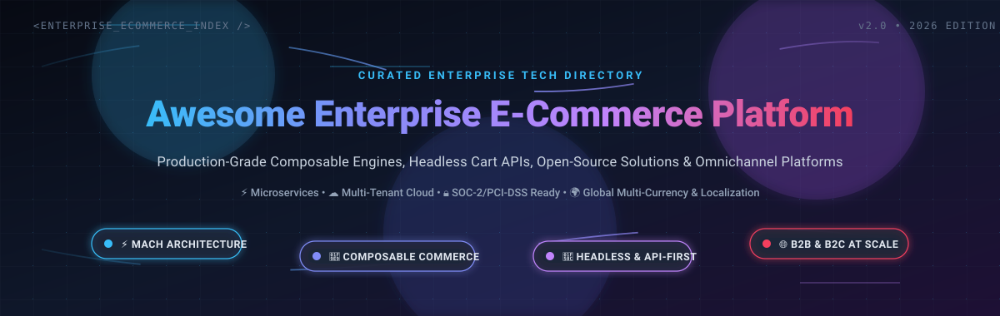

<div align="center">



# ⚡ Awesome Enterprise E-Commerce Platform 🛒

<p align="center">
  <a href="https://github.com/ishandutta2007/Awesome-Awesome-Awesome"></a><a href="https://discord.gg/jc4xtF58Ve"></a>
  <a href="https://github.com/ishandutta2007/Awesome-Enterprise-E-Commerce-Platform/stargazers"></a>
  <a href="https://github.com/ishandutta2007/Awesome-Enterprise-E-Commerce-Platform/network/members"></a>
  <a href="LICENSE"></a>
  <a href="https://github.com/ishandutta2007/Awesome-Enterprise-E-Commerce-Platform/commits/main"></a>
  <a href="https://github.com/ishandutta2007"></a>
</p>

<p align="center">
  <strong>A curated, SEO-optimized directory of enterprise digital commerce platforms, headless checkout APIs, composable MACH architectures, high-concurrency order management engines, and production-grade open-source e-commerce solutions.</strong>
</p>

---

</div>

## 📑 Table of Contents

- [🌟 Overview & Enterprise Architecture](#-overview--enterprise-architecture)
- [📊 Sector Overview & Market Dynamics](#-sector-overview--market-dynamics)
- [🏢 SaaS & Hosted Enterprise Platforms](#-saas--hosted-enterprise-platforms)
- [💻 Open-Source GitHub Projects](#-open-source-github-projects)
- [🛠️ Architectural Comparison: Monolith vs. Headless vs. Composable MACH](#️-architectural-comparison-monolith-vs-headless-vs-composable-mach)
- [🔍 SEO & Technology Taxonomy](#-seo--technology-taxonomy)
- [🤝 How to Contribute](#-how-to-contribute)
- [💖 Support & Sponsorship](#-support--sponsorship)
- [📈 Star History](#-star-history)
- [⚖️ Disclaimer](#%EF%B8%8F-disclaimer)

---

## 🌟 Overview & Enterprise Architecture

**Enterprise E-Commerce Platforms** form the mission-critical transactional foundation for global retail conglomerates, B2B wholesale manufacturers, direct-to-consumer (DTC) brands, and multi-tenant marketplace operators. Unlike entry-level storefronts, enterprise digital commerce systems handle complex multi-entity pricing matrices, customer-specific contracts, multi-warehouse distributed order management (DOM), cross-border taxation, high-concurrency flash sales, and deep bi-directional ERP/CRM data synchronization.

```
┌────────────────────────────────────────────────────────────────────────────────────────┐
│                              🌐 Omnichannel Touchpoints                                │
│   Next.js / Nuxt PWAs  •  Mobile iOS/Android  •  POS Terminals  •  IoT  •  Social API  │
└───────────────────────────────────────────┬────────────────────────────────────────────┘
                                            │ GraphQL / REST / gRPC APIs
┌───────────────────────────────────────────▼────────────────────────────────────────────┐
│                        ⚡ API Gateway & Edge Orchestration                             │
│       Rate Limiting  •  Edge Caching (Fastly/Cloudflare)  •  JWT Auth & SSO (OIDC)      │
└───────────────────────────────────────────┬────────────────────────────────────────────┘
                                            │
        ┌───────────────────────────────────┼───────────────────────────────────┐
        ▼                                   ▼                                   ▼
┌──────────────────────┐        ┌──────────────────────┐        ┌──────────────────────┐
│  📦 Product Catalog   │        │  🛒 Cart & Checkout  │        │  💳 Payments & Tax   │
│  & Multi-Region PIM  │        │  Pricing Engine & CPQ│        │  Stripe / Adyen / Tax │
└──────────────────────┘        └──────────────────────┘        └──────────────────────┘
        │                                   │                                   │
        ▼                                   ▼                                   ▼
┌──────────────────────┐        ┌──────────────────────┐        ┌──────────────────────┐
│  🏢 Distributed OMS  │        │  👥 Customer Profile │        │  🔄 ERP Sync Engine  │
│  Multi-Warehouse Routing      │  B2B Accounts & Roles│        │  SAP / NetSuite / D365│
└──────────────────────┘        └──────────────────────┘        └──────────────────────┘
```

### 🎯 Key Evaluation Pillars
- **⚡ Composable & Headless Decoupling**: Separation of presentation storefronts (Hydrogen, Vue Storefront, Next.js) from transactional business logic via REST and GraphQL endpoints.
- **🌐 B2B & Complex Wholesale Readiness**: Native support for requisition lists, custom company approval workflows, net payment terms (Net-30/60), punchout catalogs (cXML/OCI), and tiered volume discounting.
- **🔒 Security & Enterprise Compliance**: PCI-DSS Level 1 compliance, SOC 2 Type II attestation, GDPR/CCPA data governance, and role-based access control (RBAC).
- **📈 Elastic Scalability & Reliability**: Multi-cloud resilience capable of handling tens of thousands of requests per second during peak seasonal traffic spikes (Black Friday/Cyber Monday).

---

## 📊 Sector Overview & Market Dynamics

The global enterprise e-commerce platform market was valued at approximately **$8.2 Billion to $10.5 Billion in 2024**, and is projected to expand beyond **$26 Billion to $32 Billion by 2032**, demonstrating a Compound Annual Growth Rate (CAGR) of **~14.5%–16.2%**. This growth is primarily fueled by rapid enterprise digital transformation across B2B manufacturing and wholesale supply chains, alongside ubiquitous enterprise adoption of headless MACH (Microservices, API-first, Cloud-native, Headless) architectures.

In terms of competitive landscape, the sector is **moderately fragmented and undergoing dynamic structural de-concentration**. While traditional monolithic legacy incumbents (such as SAP, Salesforce, and Adobe) alongside high-scale platforms like Shopify Plus continue to command significant aggregate Gross Merchandise Value (GMV), the sector is decisively **not a winner-take-all market**. The divergent demands between full-stack turnkey SaaS, customizable mid-market open-source platforms, and modular composable microservices have fostered a vibrant, multi-polar ecosystem where best-of-breed specialized vendors thrive alongside enterprise open-source software.

---

## 🏢 SaaS & Hosted Enterprise Platforms

*Leading enterprise commercial platforms, cloud-hosted suites, and composable SaaS engines, **sorted in descending order by parent company market capitalization and estimated valuation**.*

| Platform & Provider 🌐 | Market Cap / Valuation (Company Size) 🏢 | Architecture & Key Capabilities ⚙️ | Specific Starting Pricing 💳 | Free Tier & Trial Limits ⏳ |
| :--- | :--- | :--- | :--- | :--- |
| **[Salesforce Commerce Cloud](https://www.salesforce.com/products/commerce-cloud/overview/)** | **~$280 Billion** Market Cap *(NYSE: CRM; ~$35B ARR)* | Enterprise cloud commerce powerhouse delivering unified B2C and B2B buyer journeys, native Einstein 1 AI merchandising, headless Composable Storefront, and order management. | **~$2,500 / month** *(Billed annually from $30,000/year base deployment fee or 1%–2% GMV for Starter/Growth editions; scales with total sales volume)* | **30-day guided sandbox trial** upon enterprise sales verification with 5 admin seats, preloaded B2B/B2C storefronts, and Einstein AI sample recommendation models. |
| **[SAP Commerce Cloud](https://www.sap.com/products/crm/e-commerce-platforms.html)** | **~$260 Billion** Market Cap *(NYSE: SAP; ~$34B Annual Revenue)* | Comprehensive enterprise omni-channel commerce engine (formerly Hybris) built for ultra-complex global catalogs, multi-warehouse routing, and native SAP S/4HANA ERP synchronization. | **~$12,500 / month** *(Billed annually starting from $150,000/year base cloud subscription fee; tiered strictly based on annual GMV and order throughput)* | **30-day proof-of-concept sandbox access** provisioned exclusively through authorized SAP PartnerEdge network and enterprise sales demo qualification. |
| **[Adobe Commerce](https://business.adobe.com/products/magento/magento-commerce.html)** | **~$230 Billion** Market Cap *(NASDAQ: ADBE; ~$21B Annual Revenue)* | Enterprise PaaS platform (built on Magento) offering Adobe Experience Manager (AEM) integration, Sensei AI product recommendations, Live Search, and advanced B2B quote workflows. | **~$3,333 / month** *(Billed annually starting at $40,000/year for Adobe Commerce on Cloud for <$1M GMV; on-premise self-hosted license starts at ~$1,833/mo or $22,000/yr)* | **30-day cloud staging sandbox trial** via enterprise sales demo request; plus **Free Forever** self-hosted access to upstream open-source core (*Magento Open Source*). |
| **[Shopify Plus](https://www.shopify.com/plus)** | **~$105 Billion** Market Cap *(NYSE: SHOP; ~$7.1B Annual Revenue)* | High-volume multi-tenant SaaS platform featuring 99.99% uptime, Checkout Extensibility, Hydrogen/Oxygen headless stack, B2B wholesale portals, and automated Shopify Flow pipelines. | **$2,300 / month** *(On 3-year term agreement, or **$2,500 / month** on 1-year agreement for up to $800,000 monthly GMV; 0.40% variable fee on incremental volume)* | **3-day free trial** on standard platform + **Unlimited duration development stores** via Shopify Partner accounts (full API sandbox, Hydrogen test checkouts, up to 50 test orders). |
| **[commercetools](https://commercetools.com/)** | **~$1.9 Billion** Valuation *(Series C Unicorn backed by Insight Partners & REWE; ~$100M+ ARR)* | Pioneer and founding member of the MACH Alliance delivering pure cloud-native, headless, API-first composable commerce microservices with GraphQL and multi-region elasticity. | **~$3,333 / month** *(Billed annually starting at $40,000/year for Core Commerce Edition; scales transparently based on annualized order volume)* | **60-day free trial** with unrestricted access to core GraphQL/REST APIs, Merchant Center admin console, and pre-seeded sample retail product data (no credit card required). |
| **[Sitecore OrderCloud](https://ordercloud.io/)** | **~$1.6 Billion** Valuation *(backed by EQT Partners; ~$450M ARR)* | 100% API-first, headless B2B, B2C, and B2B2X composable commerce engine engineered for intricate multi-supplier marketplaces, procurement catalogs, and custom buyer roles. | **~$4,000 / month** *(Billed annually starting at $48,000/year for enterprise base order tier up to 100,000 orders/year and enterprise SLA)* | **Free Forever Developer Sandbox** on ordercloud.io supporting unlimited API testing, test marketplace creation, catalog definitions, and simulated orders without credit card. |
| **[VTEX](https://vtex.com/)** | **~$1.3 Billion** Market Cap *(NYSE: VTEX; ~$205M Annual Revenue)* | Composable enterprise digital commerce platform with integrated native Order Management System (OMS), headless VTEX IO developer runtime, and multi-vendor marketplace engine. | **$2,000 / month** *(Minimum baseline monthly subscription billed annually from $24,000/year, or 0.5%–1.5% GMV success fee, whichever is higher)* | **14-day guided proof-of-concept sandbox** upon enterprise sales consultation and verification (or test developer workspace for certified VTEX agency network). |
| **[BigCommerce Enterprise](https://www.bigcommerce.com/enterprise/)** | **~$500 Million** Market Cap *(NASDAQ: BIGC; ~$315M Annual Revenue)* | Open SaaS enterprise e-commerce platform offering native Multi-Storefront (MSF) orchestration, built-in B2B Edition, headless framework connectors, and zero proprietary transaction fees. | **$1,499 / month** *(Billed annually starting at $17,988/year for Performance baseline tier up to $400k GMV; standard Pro tier starts at **$399 / month**)* | **15-day free trial** with complete access to storefront customizer, Multi-Storefront sandbox, checkout APIs, and unlimited mock products (no credit card required). |
| **[Spryker Cloud Commerce OS](https://spryker.com/)** | **~$500 Million+** Valuation *(Series C backed by TCV, One Peak; ~$70M+ ARR)* | Modular Packaged Business Capabilities (PBC) commerce suite engineered specifically for complex B2B manufacturing, multi-vendor marketplaces, and IoT connected commerce. | **~$5,000 / month** *(Billed annually starting around $60,000/year on AWS Marketplace based on activated PBC modules and technical core seats)* | **30-day proof-of-concept developer sandbox** provisioned upon enterprise solution scoping and sales qualification. |
| **[Elastic Path](https://www.elasticpath.com/)** | **~$250 Million** Valuation *(backed by Sageview Capital & Yaletown; ~$45M ARR)* | Composable, API-driven commerce platform providing Composable Frontend, Product Content Management (PCM), Cart/Checkout microservices, and unified multi-vendor orchestration. | **$4,125 / month** *(Billed annually starting at $49,500/year for entry tier covering up to 15,000 orders/year or up to $5M in annual GMV)* | **14-day free trial** offering full hands-on access to Commerce Manager dashboard, product catalog management, and test API checkouts without credit card. |
| **[Kibo Commerce](https://kibocommerce.com/)** | **~$200 Million** Valuation *(backed by Vista Equity Partners; ~$60M ARR)* | Modular MACH-certified composable commerce platform uniting unified B2C/B2B commerce, distributed order management (DOM), and AI-driven personalization. | **~$3,333 / month** *(Billed annually starting around $40,000/year based on order line ingestion volume and active modules; Vendr benchmark)* | **60-day evaluation sandbox trial** providing complete access to composable commerce APIs, distributed OMS, and sample inventory catalogs. |
| **[Shopware Commercial / Cloud](https://www.shopware.com/)** | **~$150 Million+** Valuation *(backed by Carlyle & PayPal Ventures; €50M+ ARR)* | European market-leading composable commerce engine with native Flow Builder, Rule Builder, Spatial Commerce 3D models, and comprehensive B2B Suite. | **$600 / month** *(€600/mo for Rise plan; Evolve Plan starts at **$2,400 / month**; Beyond enterprise tier starts from **€6,500 / month**)* | **30-day free cloud trial** of Shopware Cloud Rise with full access to administration panel, Rule Builder, and storefront; plus **Free Forever** open-source Community Edition. |

---

## 💻 Open-Source GitHub Projects

*Production-ready open-source platforms, composable headless cart engines, and modular e-commerce frameworks, **ranked in descending order by GitHub Stars_Count**.*

| Repository & Platform 🌐 | GitHub_Stars ⭐ | Primary Tech Stack 💻 | Architecture & Enterprise Capabilities 📝 | License 📜 |
| :--- | :--- | :--- | :--- | :--- |
| **[Mall](https://github.com/macrozheng/mall)** | [](https://github.com/macrozheng/mall/stargazers) | Java / Spring Boot / MyBatis | Massively popular enterprise-grade cloud commerce platform featuring microservices, multi-tier caching, dynamic permissions, and comprehensive order pipelines. | MIT |
| **[Medusa](https://github.com/medusajs/medusa)** | [](https://github.com/medusajs/medusa/stargazers) | Node.js / TypeScript | Composable, modular commerce engine and open-source Shopify alternative; features decoupled architectural modules, Next.js starter templates, and flexible workflow engine. | MIT |
| **[Bagisto](https://github.com/bagisto/bagisto)** | [](https://github.com/bagisto/bagisto/stargazers) | PHP / Laravel / Vue.js | Feature-packed enterprise e-commerce platform and multi-vendor marketplace framework with built-in multi-currency, multi-inventory, PWA, and comprehensive REST/GraphQL APIs. | MIT |
| **[Saleor](https://github.com/saleor/saleor)** | [](https://github.com/saleor/saleor/stargazers) | Python / Django / GraphQL / Next.js | High-performance, headless, composable commerce platform with GraphQL-first API, synchronous and asynchronous webhooks, multi-channel global commerce, and modern PWA storefronts. | BSD-3-Clause |
| **[Litemall](https://github.com/linlinjava/litemall)** | [](https://github.com/linlinjava/litemall/stargazers) | Java / Spring Boot / Vue.js | Complete enterprise-ready mini-program and web commerce management system with Spring Boot backend, Vue admin dashboard, and native mobile clients. | MIT |
| **[Spree](https://github.com/spree/spree)** | [](https://github.com/spree/spree/stargazers) | Ruby on Rails | Battle-tested, modular open-source e-commerce platform with REST and GraphQL APIs, multi-tenant B2B/B2C capabilities, responsive mobile storefront, and rich ecosystem of extensions. | BSD-3-Clause |
| **[Reaction Commerce](https://github.com/reactioncommerce/reaction)** | [](https://github.com/reactioncommerce/reaction/stargazers) | Node.js / GraphQL / MongoDB | Event-driven, real-time headless commerce platform built for high-throughput enterprise retail operations, inventory reservation, and modular microservices. | Apache-2.0 |
| **[Magento 2 Open Source](https://github.com/magento/magento2)** | [](https://github.com/magento/magento2/stargazers) | PHP / MySQL / Elasticsearch | The foundational open-source codebase behind Adobe Commerce, powering tens of thousands of complex global multi-store, multi-currency, and enterprise catalog deployments. | OSL-3.0 |
| **[Vue Storefront](https://github.com/vuestorefront/vue-storefront)** | [](https://github.com/vuestorefront/vue-storefront/stargazers) | TypeScript / Vue.js / Nuxt / Next.js | Leading open-source Frontend-as-a-Service (FEaaS) and composable PWA storefront connecting seamlessly to headless commerce backends including commercetools, Magento, BigCommerce, and Saleor. | MIT |
| **[WooCommerce](https://github.com/woocommerce/woocommerce)** | [](https://github.com/woocommerce/woocommerce/stargazers) | PHP / WordPress / React | World's most widely adopted open-source e-commerce engine, scaling to enterprise volumes with High-Performance Order Storage (HPOS), Action Scheduler, and headless REST APIs. | GPL-3.0 |
| **[nopCommerce](https://github.com/nopSolutions/nopCommerce)** | [](https://github.com/nopSolutions/nopCommerce/stargazers) | C# / ASP.NET Core / MS SQL | Leading Microsoft-stack open-source e-commerce platform with native multi-store, multi-vendor marketplace features, MS Azure readiness, and enterprise ERP integration. | GPL-3.0 |
| **[PrestaShop](https://github.com/PrestaShop/PrestaShop)** | [](https://github.com/PrestaShop/PrestaShop/stargazers) | PHP / Symfony / MySQL | Globally adopted modular open-source commerce platform supporting multi-language, multi-currency, advanced inventory management, and an extensive commercial marketplace. | OSL-3.0 |
| **[Aimeos](https://github.com/aimeos/aimeos-laravel)** | [](https://github.com/aimeos/aimeos-laravel/stargazers) | PHP / Laravel / Symfony | Ultra-fast, highly scalable enterprise e-commerce package capable of handling 1B+ items and 100k+ orders/day with sub-millisecond query execution and multi-tenant marketplace support. | LGPL-3.0 |
| **[Sylius](https://github.com/Sylius/Sylius)** | [](https://github.com/Sylius/Sylius/stargazers) | PHP / Symfony | Clean, test-driven modular e-commerce framework designed specifically for mid-market and enterprise custom business logic, headless REST APIs, and high code quality. | MIT |
| **[Vendure](https://github.com/vendurehq/vendure)** | [](https://github.com/vendurehq/vendure/stargazers) | TypeScript / NestJS / GraphQL | Developer-first headless e-commerce framework with end-to-end TypeScript typing, pluggable architecture, GraphQL Admin/Shop APIs, and lightweight event bus. | MIT |
| **[OpenCart](https://github.com/opencart/opencart)** | [](https://github.com/opencart/opencart/stargazers) | PHP / MVC / MySQL | Lightweight, turnkey open-source e-commerce platform featuring multi-store management, built-in affiliate tracking, coupon systems, and thousands of community plugins. | GPL-3.0 |
| **[Kill Bill](https://github.com/killbill/killbill)** | [](https://github.com/killbill/killbill/stargazers) | Java / OSGi / MySQL | Open-source enterprise billing, invoice orchestration, and subscription payments platform engineered for high-concurrency complex payment flows. | Apache-2.0 |
| **[Solidus](https://github.com/solidusio/solidus)** | [](https://github.com/solidusio/solidus/stargazers) | Ruby on Rails | Enterprise-grade, high-volume open-source commerce engine (forked from Spree) engineered for mission-critical brands needing maximum stability, modularity, and headless flexibility. | BSD-3-Clause |
| **[Shopizer](https://github.com/shopizer-ecommerce/shopizer)** | [](https://github.com/shopizer-ecommerce/shopizer/stargazers) | Java / Spring Boot / Hibernate | Enterprise-scale, headless Java web commerce engine with support for multi-location inventory, REST APIs, and multi-tenant storefront architectures. | Apache-2.0 |
| **[Pimcore](https://github.com/pimcore/pimcore)** | [](https://github.com/pimcore/pimcore/stargazers) | PHP / Symfony | Open-source enterprise Digital Experience Platform (DXP) uniting Product Information Management (PIM), MDM, DAM, CMS, and B2B/B2C transactional commerce framework. | GPL-3.0 |
| **[Lunar](https://github.com/lunarphp/lunar)** | [](https://github.com/lunarphp/lunar/stargazers) | PHP / Laravel | Headless, composable e-commerce package for Laravel applications with an integrated Filament admin panel, extensible cart pipelines, and custom product models. | MIT |
| **[Shopware Open Source](https://github.com/shopware/shopware)** | [](https://github.com/shopware/shopware/stargazers) | PHP / Symfony / Vue.js | API-first, composable open-source commerce platform powering thousands of European brands with Flow Builder, Rule Builder, and decoupled PWA frontend architecture. | MIT |
| **[Shuup](https://github.com/shuup/shuup)** | [](https://github.com/shuup/shuup/stargazers) | Python / Django | Open-source multi-vendor marketplace platform and B2B/B2C e-commerce system featuring granular vendor management, custom pricing tiers, and modular payment gateways. | OSL-3.0 |
| **[Cezerin](https://github.com/cezerin/cezerin)** | [](https://github.com/cezerin/cezerin/stargazers) | Node.js / React / MongoDB | Progressive, headless open-source e-commerce framework with decoupled React/Redux storefront, RESTful JSON API backend, and lightweight microservices. | MIT |
| **[Broadleaf Commerce](https://github.com/BroadleafCommerce/BroadleafCommerce)** | [](https://github.com/BroadleafCommerce/BroadleafCommerce/stargazers) | Java / Spring Boot | Enterprise open-source Java framework built for Fortune 500 commerce, supporting complex multi-tenant B2B pricing, hierarchical catalogs, and high-volume order pipelines. | Fair Business |
| **[GrandNode](https://github.com/grandnode/grandnode2)** | [](https://github.com/grandnode/grandnode2/stargazers) | .NET Core / MongoDB | High-performance open-source cross-platform e-commerce software powered by .NET Core and NoSQL document database, designed for multi-store and booking workflows. | GPL-3.0 |
| **[Apache OFBiz](https://github.com/apache/ofbiz-framework)** | [](https://github.com/apache/ofbiz-framework/stargazers) | Java / Apache Foundation | Full-scale open-source enterprise suite providing unified ERP, CRM, inventory and warehouse management, accounting, and omni-channel e-commerce storefronts. | Apache-2.0 |
| **[OpenMage (Magento 1 LTS)](https://github.com/OpenMage/magento-lts)** | [](https://github.com/OpenMage/magento-lts/stargazers) | PHP / MySQL | Community-driven long-term support release for legacy Magento 1.x installations, maintaining modern PHP 8.x compatibility, security patches, and performance optimizations. | OSL-3.0 |

---

## 🛠️ Architectural Comparison: Monolith vs. Headless vs. Composable MACH

When architecting an enterprise commerce ecosystem, engineering leaders evaluate three dominant paradigm models:

```
┌─────────────────────────────────┬─────────────────────────────────┬─────────────────────────────────┐
│     🏛️ Traditional Monolith     │       🔌 Headless Commerce      │    🧩 Composable MACH Stack     │
├─────────────────────────────────┼─────────────────────────────────┼─────────────────────────────────┤
│ • Coupled frontend and backend  │ • Decoupled presentation layer  │ • Decoupled microservices (PBCs)│
│ • Single code repository        │ • Headless CMS + Backend API    │ • Cloud-native multi-tenant SaaS│
│ • Slower release cycles         │ • Modern JS/TS frontends        │ • Independent scaling & deploys │
│ • Simpler initial deployment    │ • Enhanced omnichannel control  │ • Best-of-breed component swaps │
│ • Examples: Magento 2, nopComm  │ • Examples: Shopify Plus, VTEX  │ • Examples: commercetools, Kibo │
└─────────────────────────────────┴─────────────────────────────────┴─────────────────────────────────┘
```

> [!TIP]
> **Architectural Guidance**:
> - For organizations seeking **rapid time-to-market** with predictable total cost of ownership (TCO), **Shopify Plus** or **BigCommerce Enterprise** offer the fastest path to production.
> - For enterprises with **complex ERP integration (SAP/Oracle)** and strict data sovereignty, **SAP Commerce Cloud**, **Adobe Commerce**, or self-hosted **Bagisto / Saleor / Shopware** deliver deep customization.
> - For cutting-edge digital innovators demanding **zero vendor lock-in** and independent microservice deployability, a **composable MACH stack** (commercetools, Medusa, Vendure, Elastic Path) represents the state of the art.

---

## 🔍 SEO & Technology Taxonomy

To assist enterprise architects, digital transformation leads, and software engineers in discovering the ideal commerce stack:

- **Primary Categories**: Enterprise Digital Commerce, Headless E-Commerce, Composable Commerce, MACH Architecture, B2B Commerce Portals, Distributed Order Management (DOM), Multi-Storefront (MSF) Orchestration.
- **Commercial Equivalents & Open-Source Alternatives**:
  - *Shopify Plus Alternative* ➔ **Medusa**, **Saleor**, **BigCommerce Enterprise**, **Bagisto**
  - *Adobe Commerce / Magento Alternative* ➔ **Shopware**, **Sylius**, **Aimeos**, **PrestaShop**
  - *Salesforce Commerce Cloud Alternative* ➔ **VTEX**, **commercetools**, **Broadleaf Commerce**
  - *SAP Commerce Cloud Alternative* ➔ **Spryker**, **Apache OFBiz**, **Pimcore**, **nopCommerce**
  - *Elastic Path / Kibo Alternative* ➔ **Vendure**, **Reaction Commerce**, **Solidus**
- **Supported Technologies & Standards**: GraphQL, REST, gRPC, OIDC/OAuth2, PCI-DSS Level 1, ISO 27001, SOC 2 Type II, Webhooks, Next.js, Nuxt, PWA, Hydrogen, Docker, Kubernetes.

---

## 🤝 How to Contribute

Contributions from software engineers, solutions architects, and enterprise commerce specialists are enthusiastically welcomed!

1. 🍴 **Fork** this repository.
2. 🌿 **Create a new branch**: `git checkout -b feat/add-new-commerce-engine`
3. ✏️ **Add your entry** adhering to the exact tabular schema, including verified specific pricing, explicit free tier limits, or GitHub Stars_Count badges (`style=social&color=white`).
4. 🚀 **Commit & Push**: `git commit -m "Add [Platform Name] to Enterprise E-Commerce directory"`
5. 📬 **Submit a Pull Request** with a brief summary of how the platform serves enterprise workloads.

Please review our [Awesome-Awesome-Awesome Guidelines](https://github.com/ishandutta2007/Awesome-Awesome-Awesome) before submitting.

---

## 💖 Support & Sponsorship

If you find this directory valuable for benchmarking software licenses, evaluating enterprise RFPs, or architecting next-generation digital commerce infrastructure, please consider supporting the project:

- ⭐ **Star** this repository on GitHub to boost visibility across the developer community.
- 🔄 **Fork & Share** with your fellow engineering leaders, enterprise architects, and e-commerce directors.
- ☕ **Buy Me a Coffee / Sponsor**: Support ongoing independent curation, pricing research, and open-source updates via the [GitHub Sponsor Dashboard](https://github.com/sponsors/ishandutta2007).

Thank you for championing open, composable, and high-performance digital commerce! 🙏

---

## 📈 Star History

[](https://star-history.dera.page/#ishandutta2007/Awesome-Enterprise-E-Commerce-Platform&type=date&legend=top-left)

---

## ⚖️ Disclaimer

*This directory is community-curated for informational, architectural, and educational purposes. Mention of commercial products, trademarks, or registered logos does not imply direct endorsement, sponsorship, or commercial affiliation. Always perform formal due diligence, vendor security reviews (SOC 2, ISO 27001, PCI-DSS), and independent performance benchmarks prior to enterprise production deployment.*

---

<div align="center">

**Built with ❤️ for Solutions Architects, Enterprise Engineers, and Digital Commerce Innovators.**  
*Let's build frictionless, lightning-fast digital buying experiences.*

</div>
